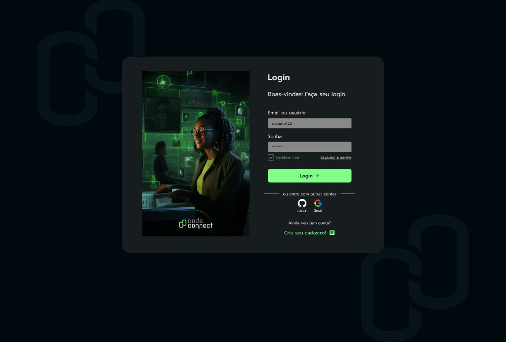
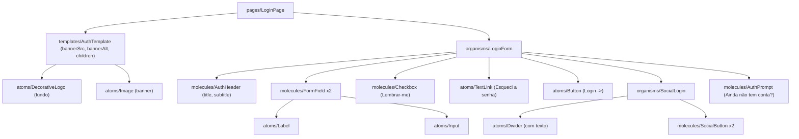

# Página de Login — Code Connect (Atomic Design + Tailwind)

Implementar a página de login conforme o layout enviado, com componentes em **Atomic Design**, estilizados com **Tailwind CSS** e com testes para todos os componentes. A estrutura será pensada para que a futura página de **Cadastro** reaproveite o mesmo layout base (card com banner + formulário), trocando apenas o banner e os campos.



## Estado atual

`apps/web` ainda é o **template padrão do Vite** (`App.tsx` de demonstração, `App.css`, `index.css`). Não tem:
- Tailwind CSS
- Vitest / Testing Library (o AGENTS.md exige testes para todo componente)
- Router

## Revisão necessária

> [!IMPORTANT]
> **Novas dependências** (todas via `pnpm --filter web add ...`, executadas fora do sandbox):
> - Runtime: `react-router` (rotas `/login` e futura `/cadastro`), `clsx`, `tailwind-merge`
> - Dev: `tailwindcss`, `@tailwindcss/vite`, `vitest`, `jsdom`, `@testing-library/react`, `@testing-library/user-event`, `@testing-library/jest-dom`
>
> Novos scripts em `apps/web/package.json`: `test` e `test:watch`. **Adiciono também `test:web` na raiz** (é só um script novo, os existentes não mudam).

> [!WARNING]
> O boilerplate do Vite (`App.css`, `assets/react.svg`, `assets/vite.svg`, `assets/hero.png` e o conteúdo de demo do `App.tsx`) será **removido**, e o `index.css` será substituído pelo setup do Tailwind.

## Perguntas em aberto

1. **Comportamento do submit**: ainda não há endpoint de autenticação na API. Proposta: o formulário é controlado, faz validação básica no cliente (campos obrigatórios) e chama uma prop `onSubmit(credentials)`. A página só registra no console / deixa um `TODO` para integrar com a API depois. Pode ser assim?
2. **Login social (GitHub/Gmail)**: proposta: botões que chamam um handler `onSocialLogin('github' | 'google')`, sem OAuth real por enquanto.
3. **Links "Esqueci a senha" e "Crie seu cadastro!"**: vão usar `<Link>` do router para `/esqueci-senha` e `/cadastro` (rotas que ainda não existem). Prefere assim ou `href="#"` por enquanto?
4. **Fonte**: o layout parece usar **Prompt** (Google Fonts), a mesma do projeto Code Connect da Alura. Posso carregar ela pelo `index.html`?

---

## Design tokens (Tailwind v4 `@theme`)

Valores tirados do layout:

| Token | Valor | Uso |
|---|---|---|
| `--color-ink` | `#01080E` | fundo da página |
| `--color-surface` | `#171D1F` | card |
| `--color-primary` | `#81FE88` | botão, links de destaque, checkbox |
| `--color-field` | `#888888` | fundo dos inputs |
| `--color-offwhite` | `#E1E1E1` | textos principais |
| `--color-muted` | `#BCBCBC` | textos secundários |
| `--color-deco` | `#132E35` | logos decorativos do fundo |
| `--font-sans` | `"Prompt", sans-serif` | |

## Mapa de componentes



**Pontos de reuso para o Cadastro:**
- `AuthTemplate` recebe `bannerSrc`/`bannerAlt` + `children` → o Cadastro só passa outro banner e um `RegisterForm`.
- `AuthHeader`, `FormField`, `Checkbox`, `Button`, `SocialLogin` e `AuthPrompt` são genéricos (textos e links via props). Por exemplo, o `AuthPrompt` do cadastro seria "Já tem conta? → Faça seu login!".
- O `SocialLogin` recebe `label` ("ou entre com outras contas" / "ou cadastre-se com").

## Mudanças propostas

### Infra / Configuração

#### [MODIFY] vite.config.ts
```ts
/// <reference types="vitest/config" />
import react from '@vitejs/plugin-react'
import tailwindcss from '@tailwindcss/vite'
import { defineConfig } from 'vite'

export default defineConfig({
  plugins: [react(), tailwindcss()],
  test: {
    environment: 'jsdom',
    globals: true,
    setupFiles: ['./src/test/setup.ts'],
    css: false,
  },
})
```

#### [NEW] src/test/setup.ts
`import '@testing-library/jest-dom/vitest'` + `cleanup` depois de cada teste.

#### [MODIFY] tsconfig.app.json
Adicionar `"vitest/globals"` e `"@testing-library/jest-dom"` em `types`.

#### [MODIFY] package.json (web)
```diff
   "scripts": {
     "dev": "vite",
     "build": "tsc -b && vite build",
     "lint": "oxlint",
-    "preview": "vite preview"
+    "preview": "vite preview",
+    "test": "vitest run",
+    "test:watch": "vitest"
   },
```
#### [MODIFY] package.json (raiz)
```diff
+    "test:web": "pnpm --filter web test",
```

#### [MODIFY] index.html
`lang="pt-BR"`, título "Code Connect", e preconnect + stylesheet da fonte Prompt.

#### [MODIFY] src/index.css
```css
@import "tailwindcss";

@theme {
  --color-ink: #01080e;
  --color-surface: #171d1f;
  --color-primary: #81fe88;
  --color-field: #888888;
  --color-offwhite: #e1e1e1;
  --color-muted: #bcbcbc;
  --color-deco: #132e35;
  --font-sans: "Prompt", ui-sans-serif, system-ui, sans-serif;
}

@layer base {
  body { @apply bg-ink font-sans text-offwhite antialiased; }
}
```

#### [NEW] src/lib/cn.ts
Helper `cn(...inputs)` = `twMerge(clsx(inputs))`.

#### [DELETE] src/App.css, src/assets/react.svg, src/assets/vite.svg, src/assets/hero.png

---

### Atoms (`src/components/atoms/`)
Cada um vai numa pasta própria com `Component.tsx`, `Component.spec.tsx` e `index.ts`.

| Componente | Responsabilidade | Props principais |
|---|---|---|
| `Button` | botão com variantes, suporta ícone | `variant: 'primary' \| 'ghost'`, `fullWidth`, `icon`, `disabled`, + props nativas |
| `Input` | input estilizado (fundo `field`, texto escuro) | props nativas, `invalid` |
| `Label` | label de formulário | `htmlFor`, `children` |
| `TextLink` | link (router `Link`) com variantes | `to`, `variant: 'default' \| 'primary'`, `underline` |
| `Divider` | linha horizontal com texto opcional no centro | `label?` |
| `Icon` | SVGs inline simples (`arrow-right`, `clipboard`, `check`) | `name`, `className` |
| `DecorativeLogo` | logo "corrente" do Code Connect em SVG, para o fundo | `className` |

Exemplo (Button):
```tsx
const variants = {
  primary: 'bg-primary text-ink hover:brightness-110',
  ghost: 'bg-transparent text-offwhite hover:text-primary',
}
export function Button({ variant = 'primary', fullWidth, icon, className, children, ...rest }: ButtonProps) {
  return (
    <button
      className={cn(
        'inline-flex items-center justify-center gap-2 rounded-lg px-4 py-3 text-sm font-semibold transition disabled:cursor-not-allowed disabled:opacity-50',
        variants[variant], fullWidth && 'w-full', className)}
      {...rest}
    >
      {children}{icon}
    </button>
  )
}
```

### Molecules (`src/components/molecules/`)

| Componente | Composição | Props |
|---|---|---|
| `FormField` | `Label` + `Input` + mensagem de erro | `id`, `label`, `error?`, + props do input |
| `Checkbox` | checkbox nativo com estilo (`accent`/borda primary) + texto | `id`, `label`, `checked`, `onChange` |
| `SocialButton` | `<button>` com imagem do provedor + legenda | `iconSrc`, `label`, `onClick` |
| `AuthHeader` | `h1` "Login" + subtítulo | `title`, `subtitle` |
| `AuthPrompt` | texto + `TextLink` primary com ícone | `question`, `linkLabel`, `to`, `icon?` |

### Organisms (`src/components/organisms/`)

#### [NEW] SocialLogin
`Divider` com label + lista de `SocialButton`s, configurada via prop:
```tsx
type Provider = 'github' | 'google'
const providers = [
  { id: 'github', label: 'Github', iconSrc: '/github.png' },
  { id: 'google', label: 'Gmail', iconSrc: '/google.png' },
]
<SocialLogin label="ou entre com outras contas" onSelect={(p) => ...} />
```

#### [NEW] LoginForm
Formulário controlado (`useState`) com `email`, `password`, `remember`; validação de campos obrigatórios; chama `onSubmit({ identifier, password, remember })`. Inclui `AuthHeader`, 2× `FormField`, linha `Checkbox` + "Esqueci a senha", `Button` "Login →", `SocialLogin` e `AuthPrompt` ("Ainda não tem conta?" / "Crie seu cadastro!").

### Templates (`src/components/templates/`)

#### [NEW] AuthTemplate
```tsx
type AuthTemplateProps = { bannerSrc: string; bannerAlt: string; children: ReactNode }

<main className="relative flex min-h-screen items-center justify-center overflow-hidden bg-ink p-6">
  <DecorativeLogo className="pointer-events-none absolute -top-10 left-16 w-56 text-deco" />
  <DecorativeLogo className="pointer-events-none absolute -bottom-10 right-16 w-56 text-deco" />
  <section className="relative z-10 flex w-full max-w-4xl flex-col gap-10 rounded-3xl bg-surface p-10 md:flex-row">
    
    <div className="flex flex-1 flex-col justify-center">{children}</div>
  </section>
</main>
```
Responsivo: no mobile o banner fica oculto e o formulário ocupa o card inteiro.

### Pages / Rotas

#### [NEW] src/pages/LoginPage.tsx (+ spec)
```tsx
<AuthTemplate bannerSrc="/banner.png" bannerAlt="Pessoa programando em ambiente com telas verdes">
  <LoginForm onSubmit={handleLogin} onSocialLogin={handleSocial} />
</AuthTemplate>
```

#### [MODIFY] src/App.tsx
`BrowserRouter` com rotas `/login` → `LoginPage` e `/` → `<Navigate to="/login" />`. Espaço reservado para `/cadastro`.

---

## Estrutura final

```text
apps/web/src/
├── components/
│   ├── atoms/        Button, Input, Label, TextLink, Divider, Icon, DecorativeLogo
│   ├── molecules/    FormField, Checkbox, SocialButton, AuthHeader, AuthPrompt
│   ├── organisms/    SocialLogin, LoginForm
│   └── templates/    AuthTemplate
├── pages/            LoginPage
├── lib/cn.ts
├── test/setup.ts
├── App.tsx, main.tsx, index.css
```

## Plano de verificação

### Testes automatizados
Cada componente terá um `*.spec.tsx` cobrindo o essencial (renderização, eventos, estados e variantes), por exemplo:
- `Button`: renderiza texto e ícone, dispara `onClick`, não dispara quando `disabled`, aplica a variante.
- `FormField`: associa label↔input (`getByLabelText`), mostra erro com `aria-invalid`.
- `LoginForm`: preenche os campos com `user-event` → submit chama `onSubmit` com os valores; submit vazio mostra erros e não chama `onSubmit`; clicar em GitHub/Gmail chama `onSocialLogin`.
- `AuthTemplate`: renderiza banner com alt e children.

Comandos (a partir da raiz):
```powershell
pnpm run test:web
pnpm run lint
pnpm run build
```

### Verificação manual
Rodar `pnpm run dev:web` (fora do sandbox), abrir http://localhost:5173/login e comparar com o layout de referência: card central, logos decorativos no fundo, banner à esquerda, formulário à direita, hover/foco nos elementos, e layout mobile (banner escondido).

